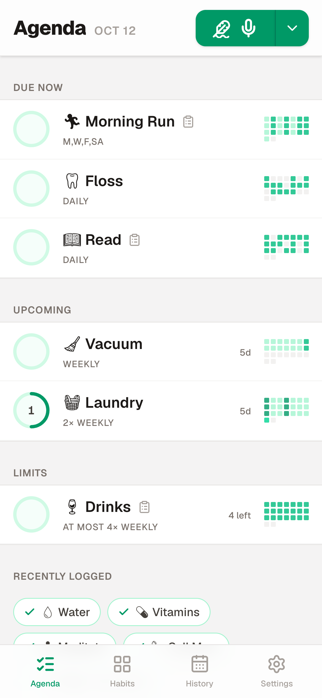
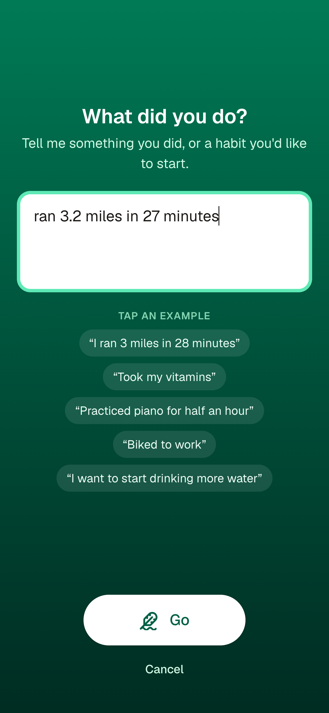
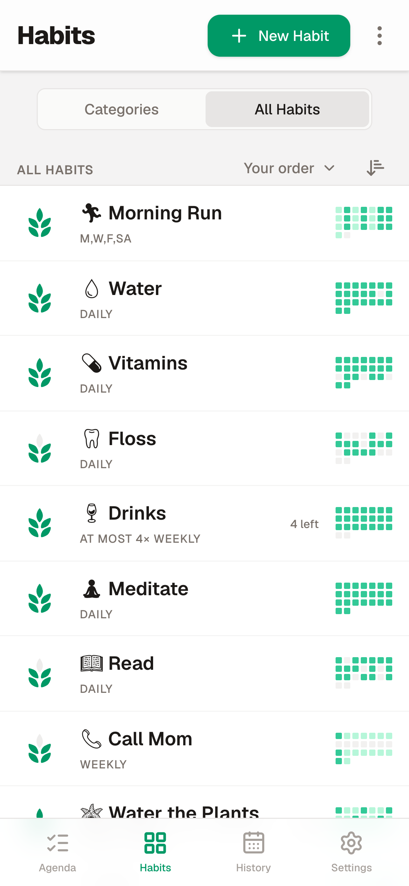
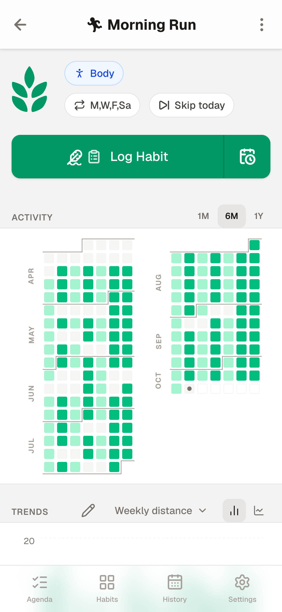
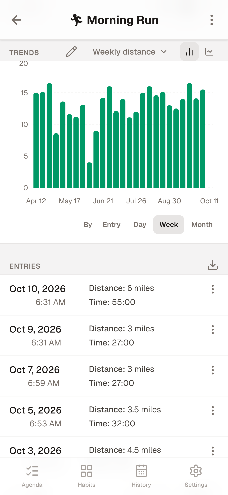
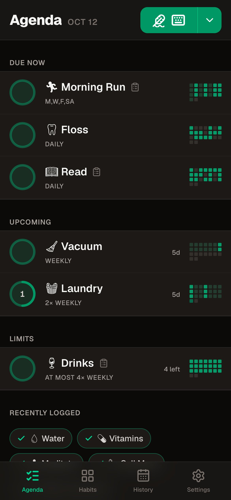

# Concerning Habits

A self-hosted, AI-powered habit tracker for you and your household. Install it on your phone as an app (a PWA), describe a habit in plain words and let AI design how you'll track it, then log by tapping, talking, typing or snapping a photo.

<table>
  <tr>
    <td align="center"><br><sub>What's due today</sub></td>
    <td align="center"><br><sub>Say or type what you did</sub></td>
    <td align="center"><br><sub>Habit health at a glance</sub></td>
  </tr>
  <tr>
    <td align="center"><br><sub>Six months of a habit</sub></td>
    <td align="center"><br><sub>Charts from your own fields</sub></td>
    <td align="center"><br><sub>Light and dark</sub></td>
  </tr>
</table>

- **Habits shaped to you:** custom fields designed by AI (or built by hand), flexible schedules and limits, categories, skips and vacations
- **Quick logging:** a tap on the Agenda, or "ran 3 miles in 28 minutes" by voice or text, filled in for you
- **Works offline** once installed: changes sync when you're back online
- **Charts, calculated fields, and habit health** instead of streaks
- **Shared habits** for a household, with users managed by an admin
- **Reminders** by push notification, an **API** for iOS Shortcuts, Home Assistant and NFC tags, and **MQTT**
- **Your data stays yours:** one SQLite database on your server, with backup and restore as JSON or CSV

Concerning Habits isn't taking outside contributions right now. Notes on working on the code are in [DEVELOPMENT.md](DEVELOPMENT.md).

## Quick Start

You need Docker with Docker Compose. For the AI features you also need an AI model: a Google Gemini API key by default, or another provider or a model running on your own machine (see [Choosing an AI Model](#choosing-an-ai-model)). Without one, you can still build habits by hand and log them.

1. Create a folder with a `docker-compose.yml` file in it, containing:

   ```yaml
   services:
     concerning-habits:
       # The latest release. To only take updates within a major version (no breaking changes), use a
       # tag like :1 instead; :1.2 takes only bug fixes. Releases: https://github.com/stevenmfarrell/concerninghabits/releases
       image: ghcr.io/stevenmfarrell/concerninghabits:latest
       container_name: concerning-habits
       ports:
         - "3000:3000"
       environment:
         # Add your Gemini API key for AI features, or choose another model (see "Choosing an AI Model")
         - GOOGLE_GENERATIVE_AI_API_KEY=your-google-gemini-api-key
         # - AI_MODEL=local:qwen3:8b
         # - AI_BASE_URL=http://host.docker.internal:11434/v1
         # Optional: a TypeSafe API key for matching "I did..." to a habit (see "Matching What You Say to a Habit")
         # - TYPESAFE_API_KEY=your-typesafe-api-key

         # Optional: Home Assistant (MQTT) Integration
         # - MQTT_URL=mqtt://homeassistant.local:1883
         # - MQTT_USERNAME=your-username
         # - MQTT_PASSWORD=your-password
         # - MQTT_TOPIC_PREFIX=concerninghabits

         # Optional: reminders (Web Push). Keys are generated and stored in the database on first use;
         # set these only to supply your own. The subject defaults to the first admin's email.
         # - VAPID_PUBLIC_KEY=...
         # - VAPID_PRIVATE_KEY=...
         # - VAPID_SUBJECT=mailto:you@example.com

         # Optional: the sign-in cookie is https-only when the request came over https (as your reverse
         # proxy reports it in X-Forwarded-Proto). Set true if your proxy terminates TLS without sending
         # that header, so the cookie is never sent over plain http.
         # - COOKIE_SECURE=true
       volumes:
         - concerning-habits_data:/app/data
       restart: unless-stopped

       # Hardening: the image already runs as an unprivileged user (uid 1001) that can only write to
       # /app/data. These additionally drop every Linux capability, block privilege escalation, and
       # make the rest of the filesystem read-only (Next.js only needs a writable /tmp and cache).
       cap_drop:
         - ALL
       security_opt:
         - no-new-privileges:true
       read_only: true
       tmpfs:
         - /tmp
         - /app/.next/cache:uid=1001,gid=1001

   volumes:
     concerning-habits_data:
   ```

2. Put in your AI key (or [another model's settings](#choosing-an-ai-model)), and uncomment any optional settings you want.
3. Start it from that folder:
   ```bash
   docker compose up -d
   ```
4. Open `http://localhost:3000`, or `http://<server address>:3000` from another device on your network, and create the admin account. The first person to open it gets to, so do this before exposing it to the internet.
5. Add family members under Settings → Family Users.

Images are published for `linux/amd64` and `linux/arm64` (including Raspberry Pi and most ARM NAS boxes). The database lives in the `concerning-habits_data` volume, and is set up and kept up to date automatically each time the container starts.

## Using HTTPS

Plain http works for signing in and using the app. **Installing it as an app on your phone, and reminders, need https.** The usual way is a reverse proxy in front of the container. With [Caddy](https://caddyserver.com), which gets a certificate for you, the whole config for a domain pointing at your server is:

```
habits.example.com {
    reverse_proxy localhost:3000
}
```

Nginx Proxy Manager, Traefik, Cloudflare Tunnel and Tailscale (`tailscale serve`) work too. Whatever you use, have it send `X-Forwarded-Proto` (most do by default) so the app knows the connection is secure, or set `COOKIE_SECURE=true`.

Then open the https address on your phone and use the browser's **Install app** or **Add to Home Screen**. On iPhone and iPad, it has to be added to the Home Screen before reminders can be turned on.

## Choosing an AI Model

Designing a habit's form, filling in entries from what you say, type or photograph, and suggesting charts and formulas all use one model, set with `AI_MODEL` as `<provider>:<model>`. It defaults to `google:gemini-flash-lite-latest`.

| Provider | Example `AI_MODEL` | Also set |
| --- | --- | --- |
| Google Gemini | `google:gemini-flash-lite-latest` | `GOOGLE_GENERATIVE_AI_API_KEY` |
| Anthropic | `anthropic:claude-haiku-4-5` | `ANTHROPIC_API_KEY` |
| OpenAI | `openai:gpt-5-mini` | `OPENAI_API_KEY` |
| Local / OpenAI-compatible | `local:qwen3:8b` | `AI_BASE_URL`, and `AI_API_KEY` if the server needs one |

`local` works with any server that speaks the OpenAI chat API: Ollama (`AI_BASE_URL=http://localhost:11434/v1`), LM Studio (`http://localhost:1234/v1`), llama.cpp's server, vLLM, LiteLLM or OpenRouter. From inside Docker, reach a server on the host at `host.docker.internal` rather than `localhost`. A few things to know about local models:

- Every request asks for a JSON answer matching a schema. Small models get this wrong more often, designing a habit's form most of all, so prefer a model of around 8B parameters or more.
- Logging from a photo needs a model that accepts images.
- A thinking model (e.g. Qwen 3.5) thinks before every answer, which on a laptop can take 20 seconds or more. Set `AI_REASONING_EFFORT=none` to turn that off (see below). With Qwen 3.5 4B it took a request from about 20 seconds to about 1, with the same answers.
- Matching what you say to a habit can use this model too (see below).

`AI_REASONING_EFFORT` sets how much a thinking model thinks before answering, with any provider: `none`, `minimal`, `low`, `medium`, `high` or `xhigh` (or `provider-default`, the same as leaving it unset). Each provider maps it to its own setting: `reasoning_effort` for OpenAI and local servers, a thinking budget for Gemini, extended thinking for Claude. The app's requests are short form fills and lookups, so `none` is usually the right choice.

### Matching What You Say to a Habit

The Agenda's "I did..." button, `POST /api/log`, and "I did..." text queued while offline first work out which of your habits you meant. `HABIT_MATCHER` chooses how:

| `HABIT_MATCHER` | How | Needs |
| --- | --- | --- |
| `jev` | TypeSafe's Jev. The most accurate, with calibrated confidence. | `TYPESAFE_API_KEY` |
| `llm` | The model set by `AI_MODEL`. More likely to ask which habit you meant. | A working `AI_MODEL` |
| `none` | No AI: "I did..." always asks, listing the habits that share words with what you said. `/api/log` and queued text without a habit log nothing, so log to a habit directly. | Nothing |

Left unset, it's `jev` if `TYPESAFE_API_KEY` is set, otherwise `llm` if the AI model is set up, otherwise `none`. However they're matched, `/api/log` and queued text only log to a habit the matcher is sure of.

## Reminders

Habit reminders are Web Push notifications, turned on per device under Settings → Reminders and per habit on its page. They need [https](#using-https). The keys for sending them are generated on first use, so there's nothing to set up.

## Offline

Installed as an app, Concerning Habits keeps working without a connection:

- **Opening it:** the app keeps a copy of each page you visit, plus the tabs and the habit and category pages they link to. Online, pages always come from the server; the copies are only used when it can't be reached. A page never opened on the device shows a short offline notice instead.
- **Making changes:** logging, editing or deleting an entry, and skipping, keep working. If the server can't be reached, the change is kept on the device and sent once it can, with the time it was actually made. A pill above the bottom nav says how many are waiting. Anything said or typed for AI to fill in (voice, or the Agenda's "I did…") is kept as text and filled in once it's sent. Logging from a photo needs a connection.
- **When a change can't be made** (say the habit was deleted meanwhile, or its form now needs a value the entry doesn't have), it's kept as "Couldn't sync". From there you can finish it by hand, try again, or discard it. Nothing is dropped silently.

Copies of pages are cleared on signing out. Changes waiting on a shared device are only ever sent for the person who made them.

## Logging from Other Apps (API)

Other apps (iOS Shortcuts, Home Assistant, Tasker, an NFC tag) can log and read entries with an API key, made under Settings → API Keys. A key acts as its user and is allowed to log, read, or both (chosen when it's made, and changeable later). It can't change or delete anything. Send it as `Authorization: Bearer ch_...` or `X-API-Key: ch_...`, or for an app that can't set headers, as `?key=ch_...` in the URL. Settings → API Keys documents each route with examples.

- `POST /api/habits/<habit id>/log` (a key that can log) logs one habit. The body is optional JSON: `{"values": {"distance": 3}}` with the habit's field keys, and/or `{"text": "ran 3 miles"}` for AI to fill them in, plus an optional `"at"` (an ISO 8601 date and time) for an earlier entry. Each habit's address, field keys and an example request are in its ⋮ menu → Log from Another App.
- `GET /api/habits/<habit id>/entries?limit=10` (a key that can read) returns the habit's latest entries, newest first (1 to 100, 10 by default), each with who logged it.
- `POST /api/log` (a key that can log) with `{"text": "ran 3 miles in 25 minutes"}` works out which habit was meant, like the Agenda's "I did..." button. It never creates a habit, and logs nothing (answering 422 with its best guesses) when it isn't sure.

Both answer `201` with the new entry. A key can make 600 requests an hour, and requests with `text` count toward the user's AI limit.

## Home Assistant (MQTT)

Set `MQTT_URL` (plus `MQTT_USERNAME` and `MQTT_PASSWORD` if your broker needs them) and every entry logged is published to an MQTT broker such as Home Assistant's, as JSON on `concerninghabits/users/<user>/habits/<habit>/log` (retained, so Home Assistant has the latest after a restart). `MQTT_TOPIC_PREFIX` changes the `concerninghabits` part. To log *from* Home Assistant, use the [API](#logging-from-other-apps-api).

## Backups

- **From the app:** Settings → Backup & Restore downloads your data as JSON, or as CSV for a spreadsheet, and restores from either. Each person's backup has their own habits, entries and settings; habits shared with them belong to whoever owns them.
- **The whole server:** everyone's data is one SQLite file, `/app/data/concerning_habits.db` inside the container (set by `DATABASE_URL`, which there's no need to change). Stop the container and copy it out:
  ```bash
  docker compose stop
  docker compose cp concerning-habits:/app/data ./habits-backup
  docker compose start
  ```

## Upgrading

Check the [release notes](https://github.com/stevenmfarrell/concerninghabits/releases) first: a new major version (e.g. 1.x to 2.0) means something needs your attention, and its notes say what. [Back up](#backups), then pull the new image and restart:

```bash
docker compose pull
docker compose up -d
```

Database changes are applied automatically on startup.

## License

Copyright 2026 Steven Farrell.

Concerning Habits is free software, licensed under the [GNU Affero General Public License v3.0](LICENSE) (AGPL-3.0-only). In short:

- **You can** use it for any purpose, self-host it, read and modify the code, and share it, including commercially.
- **If you share a modified version, or run one as a service others use over a network**, you must make your modified source code available to those users under the same license.

See [LICENSE](LICENSE) for the full terms.
